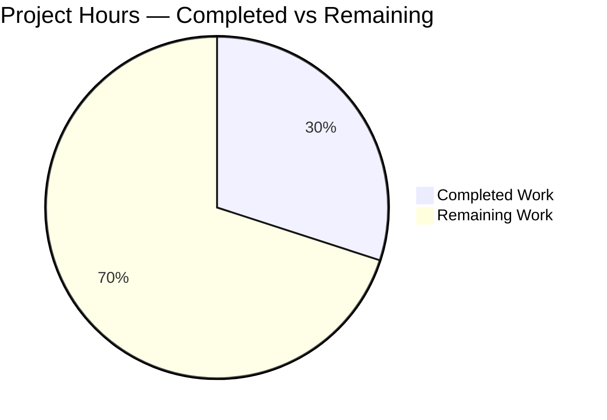
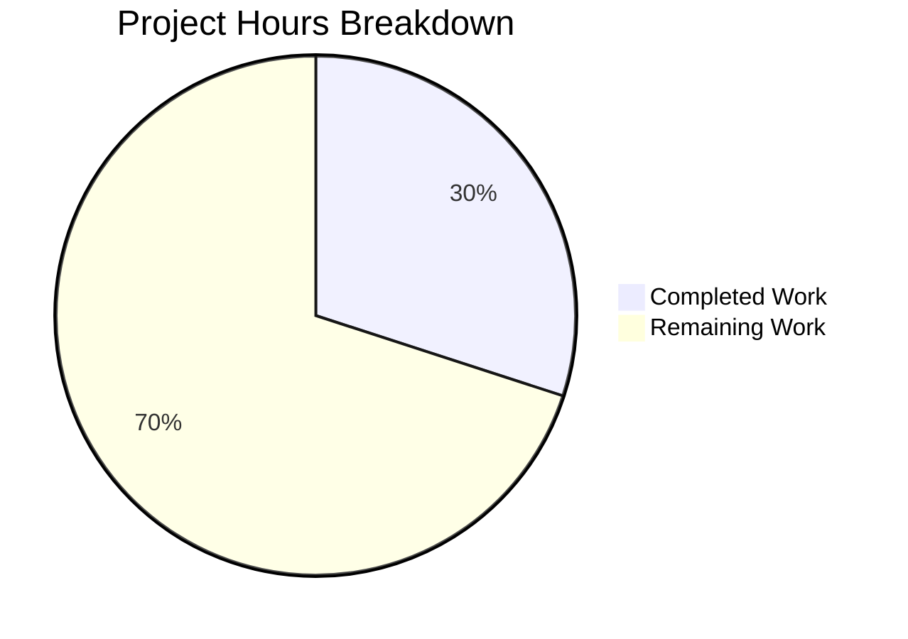

# 1. Executive Summary

## 1.1 Project Overview

The project turns a single-file Node.js service from a catch-all greeting into a path-routed surface: `GET /good-evening` was added while `GET /` was preserved byte-for-byte, the service moved onto an Express HTTP layer, and a root `package.json` declares that dependency for the first time. It serves two plain-text responses over TCP port 3000, with no accounts, data store or configuration. Scope is two files: `server (1).js` and the manifest. The impact is one additional documented endpoint on an otherwise unchanged service, with its boot, readiness and failure behaviour intact.

## 1.2 Completion Status

Every requirement of the agreed plan is delivered and verified; what remains is release readiness, not feature work.



Slice colours: **Completed Work — Dark Blue (#5B39F3)**; **Remaining Work — White (#FFFFFF)**. Completion: **30.0 %** (9.0 h ÷ 30.0 h × 100).

| Metric | Hours |
|---|---|
| Total Hours | 30.0 |
| Completed Hours (AI + Manual) | 9.0 |
| Remaining Hours | 21.0 |

## 1.3 Key Accomplishments

- `GET /good-evening` returns its exact 13-byte body at 200 with `text/plain; charset=utf-8` (`server (1).js:10`).
- `GET /` keeps its 14-byte greeting and 200, byte-identical to the pre-change build (`server (1).js:9`).
- Both routes come from one Express application, with the original listener and port retained (`server (1).js:9–11`).
- A root manifest declares `express` as the sole new dependency, keeping CommonJS loading (`package.json`).
- Startup is unchanged — one readiness line, empty stderr — and a contended port fails loudly with `EADDRINUSE`.
- Unmatched paths and non-GET methods fall to the framework's 404, with the reflected path escaped.

## 1.4 Critical Unresolved Issues

All four request-level deliverables are complete and verified. Seven of the 28 tracked scope items remain open: 20 application requirements complete; of 8 release-readiness items, 1 partial and 6 not started.

| Issue | Impact | Owner | ETA |
|---|---|---|---|
| A checkout installed only from the manifest cannot start: `require('lodash')` at `server (1).js:5` has no declaration | Deployment from the repository alone exits 1 with `Cannot find module 'lodash'` | Platform owner | 1.0 h |
| Hard-coded host-global port 3000, and a listener bound to all interfaces while the log text advertises loopback (`server (1).js:11`) | One instance per host; a contended start fails; reachability is wider than the startup line implies | Platform owner | 2.0 h |
| No automated regression suite, linter, type-check, build step or CI gate exists | Later edits to `server (1).js` are protected only by manual checks | QA owner | 6.0 h |
| `"express": "5"` is unpinned and no lockfile is committed (`package.json:5`) | Installs are not reproducible, `npm ci` is unavailable, and a later 5.x may change the framework defaults verified here | Developer | 1.0 h |
| `README.md` and `blitzy/documentation/Technical Specifications.md` still describe the pre-change, lodash-only state | The documented install path is incomplete and, run verbatim, rewrites the tracked manifest | Developer | 1.5 h |
| No TLS, authentication, security headers, CORS policy or rate limiting | The service cannot be exposed outside a trusted network without fronting controls | Security owner | 6.0 h |
| No health or readiness endpoint and no supervision manifest beyond the single startup line | A stopped or never-bound process is visible only through that line | Operations owner | 3.5 h |

## 1.5 Access Issues

No access issues identified: the service needs no credential, environment variable, database, broker or external endpoint, and every step here ran from a plain checkout.

## 1.6 Recommended Next Steps

1. **[High]** Make the repository bootable from its manifest: declare `lodash` or remove the unused `require` (1.0 h).
2. **[High]** Add the automated suite and CI gate over both contracts and the contended-port failure (6.0 h).
3. **[High]** Give the port and bind address a configuration surface and align the startup line (2.0 h).
4. **[Medium]** Pin the dependency, commit the lockfile, and refresh `README.md` and the repository specification (2.5 h).
5. **[Medium]** Apply the hardening and supervision the target environment needs (9.5 h).

# 2. Project Hours Breakdown

## 2.1 Completed Work Detail

| Component | Hours | Description |
|---|---|---|
| `GET /good-evening` route | 1.0 | Plan §0.5.1/§0.8.2 — an Express registration returning the 13-byte body with the declared media type at the framework default 200 (`server (1).js:10`). |
| Existing `GET /` carried onto the routed server | 1.0 | Plan §0.4.1/§0.5.2 — the greeting literal and its 200 preserved through the rewrite, with byte-identity to the pre-change response proven at runtime (`server (1).js:9`). |
| Express HTTP layer and the single chained server statement | 1.5 | Plan §0.1.3/§0.8.4 — the `express` binding, the app construction, both registrations and the retained `.listen(3000, …)` in one statement (`server (1).js:6,9–11`). |
| Server lifecycle and bind-failure behaviour | 1.5 | Plan §0.7.1 — the readiness callback fires only on a successful bind; a contended port exits 1 with no readiness line and `EADDRINUSE` on stderr (`server (1).js:9–11`). |
| Root manifest declaring the sole new dependency | 0.5 | Plan §0.8.1/§0.8.3 — exactly `name`, `version` and `"express": "5"`, with no module-type field and no lockfile (`package.json`). |
| Static checks and HTTP contract verification | 1.5 | Plan §0.5 — syntax check, manifest parse, and the whole-package gate exercising both routes' status, media type, `Content-Length`, byte-exact bodies and HEAD semantics. |
| Adversarial and regression verification | 1.5 | Plan §0.6 — unmatched and malformed input left to framework defaults, escaping of the reflected path, and an A/B byte comparison of `GET /` against the pre-change build. |
| Dependency-resolution verification | 0.5 | Plan §0.4.3 — the declaration resolves through its own install (express 5.3.0); the declaration is confirmed load-bearing by removing either side. |
| **Total** | **9.0** | |

## 2.2 Remaining Work Detail

| Category | Hours | Priority |
|---|---|---|
| Clean-checkout bootability — declare `lodash`, or remove the unused `require` at `server (1).js:5`, and verify a manifest-only install starts | 1.0 | High |
| Configurable port and bind address, with the startup line aligned to the address actually bound | 2.0 | High |
| Automated regression suite and CI gate over both route contracts, HEAD semantics, the framework-default 404 path and the contended-port failure | 6.0 | High |
| Reproducible dependency state — pin `express` and commit the lockfile the install writes | 1.0 | Medium |
| Documentation refresh — `README.md` install/run lines and the repository specification's baseline rows | 1.5 | Medium |
| Operational hardening for the deployment target — TLS or a terminating proxy, security headers, CORS policy, rate limiting, health endpoint | 6.0 | Medium |
| Deployment packaging and process supervision, including the port-occupancy precondition | 3.5 | Medium |
| **Total** | **21.0** | |

Hours basis: 9.0 completed + 21.0 remaining = **30.0 total project hours**, so completion is 9.0 ÷ 30.0 × 100 = **30.0 %**. The completed figure rests on a two-file deliverable that was read in full and exercised end to end (high confidence); the remaining figure depends on the deployment target the reader chooses for the hardening and packaging items (medium confidence).

# 3. Test Results

All counts below are from checks executed against the delivered build; the repository ships no test framework, so the project's whole-package HTTP gate and direct HTTP/process checks are the verification surface.

| Area / Category | Framework | Tests | Passed | Failed | Coverage | What This Proves |
|---|---|---|---|---|---|---|
| Route contract and HEAD semantics — both routes | Whole-package HTTP gate (Node) | 16 | 16 | 0 | Not instrumented (no coverage tool) | Both routes answer 200 with the declared media type, exact `Content-Length` and byte-exact bodies, and HEAD returns the same headers with an empty body. |
| Route contract — independent re-check | Live HTTP requests (`curl`) | 8 | 8 | 0 | Not instrumented | Status, media type, `Content-Length` and sha256 of the body agree with the contract on both routes when measured separately from the gate. |
| Unspecified input | Live HTTP requests (`curl`) | 4 | 4 | 0 | Not instrumented | An unmatched path gets the framework's 404 page, a non-GET method on a registered path gets 404, OPTIONS gets the framework's `Allow` response, and a query string changes nothing. |
| Startup, readiness and shutdown | Live process checks | 3 | 3 | 0 | Not instrumented | One process binds `*:3000`, prints the readiness line exactly once with nothing on stderr, and releases the port when signalled. |
| Contended-port (bind-failure) behaviour | Live process A/B | 3 | 3 | 0 | Not instrumented | A second instance exits 1, prints no readiness line and writes `EADDRINUSE` to stderr, while the incumbent keeps serving both routes. |
| Static checks | `node --check`, manifest parse | 2 | 2 | 0 | Not instrumented | The changed file parses as CommonJS and the manifest parses as valid JSON with the expected keys. |
| **Total** | | **36** | **36** | **0** | | |

**Not Covered**

- **No automated suite exists.** Every check above is an ad-hoc assertion or process check made against a live instance; nothing re-runs them when the file changes. A suite covering both route contracts, HEAD semantics, the framework-default 404 path and the contended-port failure is the first thing a human should add.
- **No coverage instrumentation exists** and no figure is claimed: there is no coverage tool, lint, type-check, build step or CI configuration in the repository.
- **The lodash-less boot path** was reproduced by hand rather than by a test: a checkout whose only install is the manifest exits 1 with `Cannot find module 'lodash'`. That case should become a test once the declaration is settled.
- **Nothing exercises TLS, authentication, CORS, rate limiting or a health endpoint** — none exists in the deliverable, and each was deliberately excluded from scope.
- **No deployment or supervision path is exercised**, because the repository contains none: there is no container definition, unit file or CI workflow.
- **No visual, responsive or accessibility check applies**: both routes are `text/plain` documents with no markup, style or client script, so browser rendering carries no UI risk to test.

# 4. Runtime Validation & UI Verification

Every line below was exercised against a running instance of the delivered build on TCP 3000, from a fresh boot unless stated otherwise.

- ✅ **Startup and readiness** — the process binds `*:3000` and prints `Server running at http://127.0.0.1:3000/` exactly once (41-byte stdout, 0-byte stderr).
- ✅ **`GET /`** — 200, `text/plain; charset=utf-8`, `Content-Length: 14`, body sha256 `c98c24b677eff448…`, byte-identical to the response of the pre-change build run on the same port.
- ✅ **`GET /good-evening`** — 200, `text/plain; charset=utf-8`, `Content-Length: 13`, body sha256 `15827d630bcabd8b…`, exactly one trailing line feed and no carriage return.
- ✅ **HEAD on both routes** — 200 with the same media type and `Content-Length` and an empty body.
- ✅ **Unmatched and non-GET input** — unmatched paths return the framework's 404 page (escaped reflection, no stack trace or filesystem path); `POST` on both routes returns 404; `OPTIONS` returns the framework's `Allow: GET, HEAD`; a query string is ignored.
- ✅ **Contended port** — a second instance exits 1, prints no readiness line and reports `Error: listen EADDRINUSE: address already in use :::3000`; the incumbent keeps answering 200 on both routes.
- ✅ **Shutdown** — signalling the process releases port 3000 with no error output and no orphan.
- ✅ **Dependency resolution** — `express` 5.3.0 resolves from the manifest's own install; `lodash` 4.18.1 resolves once supplied out of band, and the declaration is confirmed load-bearing by removing either side of it.
- ✅ **Browser rendering** — both routes render as unstyled plain text with no client script executed, and the 404 page renders the requested path escaped.
- ⚠ **Checkout installed only from the manifest** — the process cannot start (`Cannot find module 'lodash'`) until that package is supplied; the service itself behaves correctly once it is present.

❌ **Failing** — none: no exercised flow, endpoint or integration failed.

**Never exercised at runtime.** TLS/HTTPS, authentication, authorization, sessions, CORS, rate limiting and any health, readiness or metrics endpoint do not exist in the deliverable and were never driven. No container, orchestration or CI packaging path was exercised because the repository contains none, and no supervised restart or readiness-probe cycle was run. Load was exercised only in bounded bursts (tens of concurrent requests and several thousand sequential requests), under which open descriptors and thread count stayed flat and memory warmed up to a plateau; no sustained production-volume or multi-hour run was performed. A second instance on a different port cannot be exercised, because the port and bind address are hard-coded with no configuration surface.

# 5. Compliance & Quality Review

## 5.1 Compliance Matrix

| Deliverable | Benchmark | Status | Evidence |
|---|---|---|---|
| `GET /good-evening` contract | Functional contract fidelity | ✅ Pass | 200, `text/plain; charset=utf-8`, `Content-Length: 13`, byte-exact body (sha256 `15827d63…`) — gate and independent HTTP checks (`server (1).js:10`). |
| `GET /` preserved | Regression safety | ✅ Pass | 200, 14-byte body byte-identical to the pre-change build at runtime (`server (1).js:9`). |
| Express binding and single chained registration | Implementation completeness | ✅ Pass | `express()` with two registrations and the retained listener in one statement (`server (1).js:6,9–11`). |
| Root manifest declaring the dependency | Configuration correctness | ✅ Pass | Exactly `name`, `version` and `"express": "5"`; no module-type field, CommonJS loading preserved (`package.json`). |
| Boot, readiness and bind-failure lifecycle | Operational correctness | ✅ Pass | Exactly one readiness line per healthy boot; exit 1, no readiness line and `EADDRINUSE` on a contended port. |
| Unspecified input and framework defaults | Framework-default behaviour | ✅ Pass | 404 for unmatched paths and non-GET methods, escaped reflection, no handler or middleware added. |
| Static integrity | Syntax and parse hygiene | ✅ Pass | `node --check "server (1).js"` exits 0 with no output; the manifest parses as valid JSON. |
| Scope discipline | Change minimality | ✅ Pass | Two paths changed, 11 insertions / 3 deletions; no lockfile, test file, documentation or CI change. |
| Automated verification and coverage | Test automation | ❌ Gap | No suite, runner, coverage tool, lint or type-check exists; all verification is ad-hoc against a live instance. |
| Clean-checkout bootability | Deployment readiness | ⚠ Partial | Boots once `lodash` is supplied out of band; an install from the manifest alone exits 1 with `Cannot find module 'lodash'`. |
| Reproducible dependency state | Build reproducibility | ❌ Gap | Unpinned major line, no committed lockfile, `npm ci` unavailable. |
| Security posture and hardening | Security baseline | ❌ Gap | Plain HTTP, no TLS, authentication, security headers, CORS policy or rate limiting; listener bound to all interfaces. |

## 5.2 AAP & Rule Divergences and Gaps

No user rules were supplied for this project, so every entry below is a departure from the agreed plan or from a platform expectation that the plan itself records as superseded. Each was a decided course of action, not an oversight; the reasoning and what a human must do about it follow the table.

| What the AAP/Rule Required | What Was Delivered Instead | Why It Diverged | Impact | Remediation |
|---|---|---|---|---|
| The plan's exact diff registers both routes on the Express app and lets the app receive `.listen(3000, …)` (plan §0.8.2) | `require('http').createServer(express().get('/'…).get('/good-evening'…)).listen(3000, …)` (`server (1).js:9–11`) | Settled — a higher requirement inside the same plan (carry pre-existing behaviour over except where the new routing supersedes it) plus the repository specification F-003-RQ-003 / F-004-RQ-002, which require a loud exit on a port conflict and no readiness line on a failed boot. Adding an error handler was excluded (plan §0.6.1) | The specification's failure behaviour survives; only the statement's shape differs from the illustrative diff | None. Record it so the form is not "corrected" back |
| Dependency versions identified, installed and verified (environment checklist) | `"express": "5"` as a bare major line; no resolved release, range, hash or registry lookup (`package.json:5`) | Sanctioned — the project owner's instruction forbids version research, test installs and measured requests, recorded as binding in the plan (plan §0.6.2) | Install-time resolution can drift within 5.x, and the framework defaults verified here belong to the release resolved at install time | Pin the release and commit the lockfile (Section 2.2, 1.0 h) |
| `express` is the sole new dependency; the manifest carries only name, version and the dependency in use (plan §0.3, §0.8.3) | `server (1).js:5` still requires `lodash`, which the manifest does not declare | Sanctioned by the instruction to keep the dependency set to `express` — the unrequested require was preserved byte-for-byte per plan §0.7.1 | A checkout installed only from the manifest exits 1 before binding; the boot depends on an environment fact | Declare `lodash`, or delete the unused require, and verify a manifest-only install boots (1.0 h) |
| Reproducible dependency state | No lockfile is created or committed | Sanctioned — the project owner excluded a lockfile, and the manifest is the whole committed dependency state (plan §0.6.1) | Two installs can resolve different releases; `npm ci` cannot be used at all | Commit the lockfile the install writes and pin the version (1.0 h) |
| Documentation describes the software as shipped | `README.md` still installs lodash only; `blitzy/documentation/Technical Specifications.md` still describes the pre-change single-route server | Sanctioned — every documentation change was excluded from the request and the plan (§0.9.2) | The documented install path is incomplete and, run verbatim, rewrites the tracked manifest | Refresh both documents, including the `--no-save` form for the undeclared package (1.5 h) |
| Comments describe the code they annotate | Four identical JSDoc blocks remain, one still claiming the file responds to every request with the greeting, plus an unused `const _ = require('lodash');` binding (`server (1).js:1–3,5,8`) | Deliberate — the plan declares both artifacts of the smallest-diff constraint (§0.6.3, §0.9.2); editing either is the refactoring the request excluded | A reader without the change history can act on text that no longer matches the behaviour below it | None required. Fold a reword into any later edit of the file |
| Requested handlers, configuration and hardening | No 404 handler, error handler, environment-variable configuration, security headers, CORS policy, TLS or rate limiting | Sanctioned — each was explicitly excluded (plan §0.1.2, §0.6.1, §0.9.2); framework defaults apply, including `X-Powered-By: Express` | The service is not hardened for any exposure beyond a trusted network | Apply the hardening the deployment target requires (6.0 h) |
| Configurable, coherent network binding | Port 3000 is a hard-coded host-global literal and the listener binds all interfaces while the startup line advertises `127.0.0.1` (`server (1).js:11`) | Deliberate — the port literal and log string are carried over character-for-character (plan §0.4.1, §0.7.1); the repository specification A-004 declares the `::` bind the requirement and the loopback text display only | One instance per host; a contended start fails; the log understates who can reach the service | Add a configuration surface for port and address and align the log (2.0 h) |

**The one substantive course correction.** The plan's illustrative diff hands `.listen` to the Express app itself, and that shape is wrong for this repository: Express treats a trailing callback as a completion handler *and* installs it as the server's one-time `error` sink, so on a contended port the readiness arrow receives the error as its first argument, prints the success line, swallows the failure, and the process exits 0 having bound nothing. The delivered statement instead makes the app the request listener of a plain HTTP server — the shape the file had before the change — as the repository specification demands: exit loudly with `EADDRINUSE` and print no startup line (F-003-RQ-003), and print the readiness line only after a successful bind (F-004-RQ-002). An explicit error listener was excluded as unrequested hardening. `server (1).js:9–11` is therefore the intended form; rewriting it to match the illustrative line would reintroduce a silent failure under contention.

**The unpinned dependency.** The declared `"express": "5"` is a range, not a release, and no lockfile records what was installed; the project owner's instruction to assume the latest stable major line, without registry lookups, test installs or measured requests, is why. The consequence is concrete: the framework defaults this release exhibits — the automatic `X-Powered-By` header, the weak `ETag` and its 304 behaviour, case-insensitive and trailing-slash-tolerant path matching, and the escaping of the reflected path in the 404 page — belong to whichever 5.x the install resolves, not to the repository. Pin the release and commit the lockfile before relying on any of that as fixed behaviour.

**The undeclared runtime package.** `server (1).js:5` requires `lodash`, and the manifest deliberately declares only `express`. The instruction that `express` be the sole new dependency, combined with the requirement to leave the existing require byte-for-byte untouched, makes this a decided state rather than an omission — and the module is genuinely unused, bound to `_` and never referenced again. The practical effect is that the repository is not self-sufficient: `npm install` from the manifest yields a process that exits 1 with `Cannot find module 'lodash'` and never binds. Supplying the package out of band (`npm install --no-save`, which leaves the manifest byte-identical) or declaring it properly both resolve the boot; only declaring it makes the repository complete on its own.

**Reproducibility of the install.** No lockfile is committed, so the three-field manifest is the entire committed dependency state. That was a stated exclusion, and it has a second consequence beyond drift: `npm ci` cannot run at all, because it requires a lockfile, so any pipeline must use `npm install`. Combined with the unpinned range, this means the exact framework release behind the verified behaviour is neither fixed nor recorded anywhere in the repository. Committing the lockfile an install writes is the smallest change that closes both halves; it does not alter the manifest's field set or add a second dependency.

**Documentation left behind the code.** `README.md` still tells a reader to install lodash by hand and says nothing about the manifest dependency, and `blitzy/documentation/Technical Specifications.md` still describes a five-line server with no framework, no manifest and no routing. Both were excluded from the change, correctly, since the request permitted edits to one file only. Until they are refreshed, the repository's own instructions and specification contradict what ships — and there is a trap in the README line specifically: run verbatim once a manifest exists, `npm install lodash` saves lodash into the tracked `package.json`, changing the dependency declaration the release fixes. Refreshing both documents, and documenting the `--no-save` form, removes the contradiction.

**Comments that no longer match the code.** Four identical JSDoc blocks sit at lines 1–3 and 8, one of them immediately above the routed statement while still asserting that the file responds to every HTTP request with the greeting. Three annotate nothing at all, and the `_` binding from the lodash require is never used. The plan declares all of this a deliberate consequence of the smallest-diff constraint, and the blocks are byte-identical to the pre-change file, so this is a decided state rather than a defect. The risk is entirely downstream: an engineer reading the file without that context may treat the block as current documentation, or "tidy" it and enlarge the diff the release was constrained to keep minimal.

**Handlers, hardening and the network surface.** The service deliberately has no 404 handler, no error handler, no environment-variable configuration, no TLS, no security headers, no CORS policy and no rate limiting, and the port is a hard-coded literal shared by every checkout on a host. The framework's defaults fill the gaps: unmatched requests get the stock 404 page, `X-Powered-By: Express` identifies the stack, and a plain-HTTP listener accepts anything that can reach port 3000. None of this is reachable by a change the request allowed, and the repository specification already treats the real bind address (`::`) as the requirement with the loopback text as display only. Anything beyond a trusted network needs the hardening and the configuration surface listed under remaining work.

# 6. Risk Assessment

All risks below are conditions the reader inherits from the deliverable as it stands; none is a defect that has been left behind.

| Risk | Category | Severity | Probability | Mitigation | Status |
|---|---|---|---|---|---|
| A checkout installed only from the manifest cannot start — `lodash` is required at `server (1).js:5` but declared nowhere | Integration | High | High | Declare the package, or remove the unused require; until then install it with `--no-save` or supply a dependency tree that contains it | Open |
| Port 3000 is a hard-coded, host-global literal, so only one instance can bind it and a contended start fails loudly instead of relocating | Operational | High | High | Acquire the port deliberately before start and supervise the process; add a configuration surface so instances can be partitioned | Open |
| No automated regression protection — no test runner, linter, type-check, build step or CI gate | Technical | High | High | Add contract tests for both routes, HEAD semantics, the 404 path and the contended-port failure, and run them on every change | Open |
| Plain HTTP with no TLS, authentication, security headers, CORS policy or rate limiting, and a listener bound to all interfaces while the log advertises loopback | Security | High | Medium | Terminate TLS at a proxy, add the headers and policy the deployment requires, and restrict the bind if the host is routable | Open |
| `"express": "5"` is an unpinned range with no lockfile, so installs are not reproducible and a later 5.x may change framework defaults | Technical | Medium | Medium | Pin the release and commit the lockfile so every environment resolves identical code | Open |
| No dependency-risk visibility: no lockfile, no committed dependency tree and no audit tooling, so advisory state cannot be established from the repository | Security | Medium | Medium | Once pinned, run an audit in CI and track advisories for the fixed release | Open |
| No health, readiness or metrics endpoint beyond the single startup line, and no supervision manifest | Operational | Medium | Medium | Add a readiness endpoint and a supervised unit or container probe that restarts on failure | Open |
| Framework default headers (`X-Powered-By: Express`, weak `ETag`) identify the stack and its caching behaviour | Security | Low | High | Suppress or replace the defaults as part of the hardening pass if fingerprinting matters for the deployment | Open |

# 7. Visual Project Status



Chart colours: **Completed Work — Dark Blue (#5B39F3)**; **Remaining Work — White (#FFFFFF)**. Completed 9.0 h, remaining 21.0 h, total 30.0 h — **30.0 % complete**.

**Remaining hours by category** (the same figures as Section 2.2):

| Category | Hours | Priority |
|---|---|---|
| Automated regression suite and CI gate | 6.0 | High |
| Operational hardening for the deployment target | 6.0 | Medium |
| Deployment packaging and process supervision | 3.5 | Medium |
| Configurable port and bind address, log aligned | 2.0 | High |
| Documentation refresh | 1.5 | Medium |
| Clean-checkout bootability (`lodash` declaration or removal) | 1.0 | High |
| Reproducible dependency state (pinned version and lockfile) | 1.0 | Medium |
| **Total** | **21.0** | |

**Priority distribution:** 9.0 h High (three items — bootability, port configurability, automated verification) and 12.0 h Medium (four items — dependency pinning, documentation, hardening, deployment packaging). No remaining item is a feature of the agreed plan; all 20 plan requirements are complete, and the whole remaining figure is release readiness.

# 8. Summary & Recommendations

The service now serves two read-only HTTP routes from one process: the original greeting on `GET /`, byte-identical to what it returned before, and a new `GET /good-evening` returning `Good evening\n` at 200 with `text/plain; charset=utf-8`. Both are registered on an Express application constructed inside a single chained statement that retains the original listener, the port literal `3000` and the readiness line, and the project gained its first manifest, which declares `express` as the only new dependency and preserves CommonJS loading (`server (1).js`, `package.json`). Verification was end-to-end over real HTTP: the project's whole-package gate passed 16 of 16 checks, the two bodies were confirmed byte-exact against their expected digests, HEAD returned the same headers with an empty body, unmatched paths and non-GET methods fell to the framework's 404 page with the reflected path escaped, and a contended port failed loudly — exit 1, no readiness line, `EADDRINUSE` on stderr — while the incumbent kept serving.

Every requirement of the agreed plan is complete and verified; the outstanding work is release readiness, which is why the completion figure is **30.0 %** (9.0 h completed against 30.0 h total). Seven of the 28 tracked scope items remain open. The two that block the service outside this development host are that a checkout installed only from the manifest cannot start, because `server (1).js:5` requires an undeclared `lodash`, and that port 3000 is a hard-coded, host-global literal with no configuration surface, so a second instance cannot coexist with the first. Beyond those sit the absences the request deliberately excluded: no automated regression suite or CI gate, no pinned dependency or lockfile, documentation that still describes the pre-change server, and no TLS, security headers, CORS policy, rate limiting or health endpoint.

The critical path to production is therefore short and ordered. First, make the repository self-sufficient at boot and give the port and bind address a configuration surface, so the service can be started predictably and more than once per host. Second, add the automated suite and CI gate that turn the manual verification recorded in this guide into a check that runs on every change — without it, the next edit to `server (1).js` is unprotected. Third, pin the dependency and commit the lockfile, and refresh `README.md` and the repository specification so instructions and software agree. Last, apply the hardening and packaging the target environment requires: TLS or a terminating proxy, security headers, an explicit CORS policy, rate limiting, a readiness endpoint, and a supervised unit that asserts port availability before start. That is 21.0 h of work, of which 9.0 h is High priority.

Success for this release is measurable and modest: both routes answer with exact status, media type and bytes; one process binds TCP 3000 and prints exactly one readiness line with an empty stderr; a contended port terminates loudly rather than reporting a false start; and unmatched input stays with the framework's defaults instead of a hand-rolled handler. All of that holds today and is exercised in this guide. Production readiness, assessed against the deliverable's stated purpose — a small plain-text HTTP service — is **ready to run on a trusted host once the prerequisite install is honoured, and not ready to expose beyond one**, since it ships without transport security, authentication, hardening, reproducible dependency state or an automated safety net. Closing the first two High-priority items removes the operational blockers; the remaining five items bring it to a deployable, verifiable release.

| Metric | Value |
|---|---|
| Plan requirements complete | 20 of 20 |
| Tracked scope items complete | 21 of 28 (1 partial, 6 not started) |
| Verified checks passed | 36 of 36 |
| Completion | 30.0 % (9.0 h of 30.0 h) |
| Remaining effort | 21.0 h — 9.0 h High, 12.0 h Medium |

# 9. Development Guide

## 9.1 System Prerequisites

- **Node.js 18 or newer** — the dependency's own `engines` field requires `>= 18`; this release was built and verified on Node.js v22.23.3.
- **npm 11.x** (verified on 11.21.0). No other package manager is configured.
- **No infrastructure**: no database, cache, message broker, VPN, external endpoint or seed data. The process reads no configuration value at all and boots under an empty environment.
- **Port 3000 free on the host.** The port is a hard-coded literal with no override, so only one instance of this service can run per host.

The file name contains a space and parentheses — always quote it: `node "server (1).js"`.

## 9.2 Repository Layout

```
.
├── README.md                                 # project name, install line, run command
├── package.json                              # name, version, dependencies: { "express": "5" }
├── server (1).js                             # the whole service: two routes plus the listener
└── blitzy/documentation/Technical Specifications.md
```

There is no build step, no source tree, no test runner, no linter and no CI configuration: `server (1).js` is plain CommonJS JavaScript and loads directly.

## 9.3 Dependency Installation

```bash
# from the repository root
CI=true npm install --no-audit --no-fund
```

Expected: the install completes and `express` resolves from the local tree at the declared major line (5.3.0 when this guide was verified).

**Two things to know before you run it:**

1. **The service also requires `lodash`, which the manifest does not declare.** `server (1).js:5` loads it, so a checkout whose only install is the command above exits 1 with `Error: Cannot find module 'lodash'` and never binds. Satisfy it without touching the manifest:

```bash
CI=true npm install --no-audit --no-fund --no-save lodash   # leaves package.json byte-identical
# or point Node at a dependency tree that already contains it:
NODE_PATH=/path/to/a/tree/with/lodash node "server (1).js"
```

2. **The install writes an untracked `package-lock.json`.** This release deliberately commits no lockfile, so keep that file out of commits. Do not add `lodash` to `package.json`, and do not run `npm ci` — it requires a lockfile and exits with `EUSAGE`.

## 9.4 Static Check

```bash
node --check "server (1).js"     # exit 0, no output
node -e "JSON.parse(require('fs').readFileSync('package.json','utf8'))"   # exit 0
```

## 9.5 Starting the Service

```bash
# from the repository root
nohup node "server (1).js" >app.out 2>app.err & echo $! > app.pid
sleep 2
cat app.out
```

Expected stdout, exactly one line (41 bytes) and nothing on stderr:

```
Server running at http://127.0.0.1:3000/
```

The line is printed once the socket is bound. The listener binds every interface on port 3000; the `127.0.0.1` in the message is display text, not the bind address.

## 9.6 Verifying a Running Instance

```bash
curl -sS -o /dev/null -w 'GET /              -> %{http_code} %{content_type} %{size_download}\n' http://127.0.0.1:3000/
curl -sS -o /dev/null -w 'GET /good-evening  -> %{http_code} %{content_type} %{size_download}\n' http://127.0.0.1:3000/good-evening
curl -sS http://127.0.0.1:3000/ | sha256sum
curl -sS http://127.0.0.1:3000/good-evening | sha256sum
curl -sS -I -o /dev/null -w 'HEAD /good-evening -> %{http_code} %{size_download}\n' http://127.0.0.1:3000/good-evening
curl -sS -o /dev/null -w 'unmatched path   -> %{http_code}\n' http://127.0.0.1:3000/no-such-path
curl -sS -o /dev/null -w 'POST /           -> %{http_code}\n' -X POST http://127.0.0.1:3000/
```

Expected results:

| Check | Expected |
|---|---|
| `GET /` | `200 text/plain; charset=utf-8 14` |
| `GET /good-evening` | `200 text/plain; charset=utf-8 13` |
| sha256 of `GET /` | `c98c24b677eff44860afea6f493bbaec5bb1c4cbb209c6fc2bbb47f66ff2ad31` |
| sha256 of `GET /good-evening` | `15827d630bcabd8b6952860d86096076ffbe023080785365150032ab34a8f05c` |
| `HEAD /good-evening` | `200` with `Content-Length: 13` and an empty body |
| unmatched path | `404`, framework error page, no internals |
| `POST /` | `404` |

A second instance started while the first holds port 3000 must exit 1, print **no** readiness line, and report `Error: listen EADDRINUSE: address already in use :::3000` on its stderr:

```bash
node "server (1).js"; echo "exit=$?"     # while another instance holds :3000
```

## 9.7 Stopping the Service

```bash
kill "$(cat app.pid)"
lsof -nP -iTCP:3000 -sTCP:LISTEN || echo "port released"
```

Always stop by the pid you started and never by process name — the name matches every checkout on a shared host.

## 9.8 Example Usage

```bash
$ node "server (1).js" &
Server running at http://127.0.0.1:3000/

$ curl -sS -D - http://127.0.0.1:3000/good-evening
HTTP/1.1 200 OK
X-Powered-By: Express
Content-Type: text/plain; charset=utf-8
Content-Length: 13
ETag: W/"d-7fFyiNLFhmJrNT+BforqesSHNow"
Connection: keep-alive
Keep-Alive: timeout=5

Good evening

$ curl -sS http://127.0.0.1:3000/
Hello, World!

$ curl -sS -o /dev/null -w '%{http_code}\n' http://127.0.0.1:3000/no-such-path
404
```

Behaviour a client should expect from the framework's defaults: queries, trailing slashes and path case are tolerated (`/good-evening/` and `/Good-Evening` return the same body); percent-encoded or dot-segment paths return 404; unmatched paths and non-GET methods return 404; `OPTIONS` returns `Allow: GET, HEAD`; a conditional `GET` with a matching `If-None-Match` returns 304.

## 9.9 Troubleshooting

| Symptom | Cause | Resolution |
|---|---|---|
| `Error: listen EADDRINUSE: address already in use :::3000` with exit 1 and no readiness line | Another process owns port 3000 — the port is host-global and hard-coded | Find the owner with `lsof -nP -iTCP:3000 -sTCP:LISTEN` and stop it by pid, or wait for it to exit; a port configuration surface is still outstanding work |
| `Error: Cannot find module 'lodash'` at startup, exit 1 | The manifest declares only `express`, but line 5 requires `lodash` | Install it out of band (`--no-save`) or set `NODE_PATH`; declaring it in the manifest is the permanent fix |
| `Error: Cannot find module 'express'` | The dependency was never installed, or the wrong directory is the working directory | Run `CI=true npm install --no-audit --no-fund` from the repository root and start the file from there |
| `npm ci` exits with `EUSAGE: can only install with an existing package-lock.json` | No lockfile is committed, by design | Use `npm install`; committing the lockfile is outstanding work |
| `git status` shows an unexpected change to `package.json` after installing lodash | The README's install line, run verbatim, makes npm save the dependency into the manifest | Use the `--no-save` form and revert the manifest: it must keep exactly `name`, `version` and the `express` dependency |
| `git status` shows an untracked `package-lock.json` | Any `npm install` writes one | Leave it untracked and out of commits |
| A start looks successful but nothing is listening | Impossible on this release: a bind failure exits 1 with no readiness line | Re-read stdout and stderr — the process will have failed loudly; check the two cases above |
| No test command, lint or CI to run | The repository ships none | The verification steps in this section are the whole check surface; adding an automated suite is the highest-value outstanding task |

# 10. Appendices

## A. Command Reference

| Purpose | Command |
|---|---|
| Install the declared dependency | `CI=true npm install --no-audit --no-fund` |
| Supply the undeclared runtime package without editing the manifest | `CI=true npm install --no-audit --no-fund --no-save lodash` |
| Syntax-check the service | `node --check "server (1).js"` |
| Start the service in the background | `nohup node "server (1).js" >app.out 2>app.err & echo $! > app.pid` |
| Confirm readiness | `grep -c 'Server running at http://127.0.0.1:3000/' app.out` |
| Check the route contract | `curl -sS -o /dev/null -w '%{http_code} %{content_type} %{size_download}\n' http://127.0.0.1:3000/good-evening` |
| Check the body bytes | `curl -sS http://127.0.0.1:3000/ \| sha256sum` |
| Reproduce the bind-failure path | `node "server (1).js"; echo "exit=$?"` (while another instance holds the port) |
| Find the port owner | `lsof -nP -iTCP:3000 -sTCP:LISTEN` |
| Stop the service | `kill "$(cat app.pid)"` |
| List tracked files | `git ls-files` |

## B. Port Reference

| Port | Protocol | Purpose | Notes |
|---|---|---|---|
| 3000 | TCP (plain HTTP) | The service's only listener | Hard-coded literal in `server (1).js:11`, bound on all interfaces (`::`), with no configuration surface; only one instance per host |

## C. Key File Locations

| Path | Contents |
|---|---|
| `server (1).js` | The whole service — the two route registrations, the `express` binding and the listener (11 lines) |
| `package.json` | The repository's only manifest: `name`, `version`, `dependencies: { "express": "5" }` |
| `README.md` | Project name, the lodash install line and the documented run command |
| `blitzy/documentation/Technical Specifications.md` | Repository specification, including the requirements (F-003-RQ-001…003, F-004-RQ-001…003, A-003, A-004) that govern the listener, the readiness line and the bind address |

## D. Technology Versions

| Component | Version | Source |
|---|---|---|
| Node.js | v22.23.3 verified (any 18+) | Host runtime |
| npm | 11.21.0 | Host toolchain |
| express | declared `"5"`; 5.3.0 resolved when verified | `package.json:5` |
| lodash | 4.18.1, required at runtime but undeclared | Supplied out of band (`README.md:3`) |
| Module system | CommonJS | No `type` field in the manifest |
| Test / lint / build tooling | none | No runner, linter, type-check, build step or CI configuration exists |

## E. Environment Variable Reference

None. The service reads no environment variable, secret, configuration file or command-line argument, and it boots and serves both routes under an empty environment. The variables documented in the development guide (`CI`, `NODE_PATH`) are npm/Node conveniences for installation and module resolution, not service configuration.

## F. Developer Tools Guide

| Task | Tool | Notes |
|---|---|---|
| Editing the service | any editor | One file, 11 lines, plain CommonJS; keep the file's existing one-statement-per-line, single-quote, two-space-indent style |
| Running it | `node "server (1).js"` | Quote the name; there is no `npm start` script and none should be invented without a manifest change |
| Exercising the contract | `curl` | The commands in the development guide reproduce every runtime check described in this guide |
| Socket inspection | `lsof -nP -iTCP:3000 -sTCP:LISTEN` | The only way to see who owns the hard-coded port |
| Byte-level inspection | `od -c`, `sha256sum`, `wc -c` | Used to confirm the exact 13- and 14-byte bodies and their digests |
| Regression protection | none installed | Adding a test runner and a CI workflow is the highest-value outstanding task |

## G. Glossary

| Term | Meaning |
|---|---|
| Contract | The agreed method, path, status, media type and exact body bytes for a route |
| Readiness line | The single stdout message `Server running at http://127.0.0.1:3000/`, printed once after a successful bind |
| Bind failure | A start that cannot acquire port 3000; the process exits 1, prints no readiness line and writes `EADDRINUSE` to stderr |
| Framework default | Behaviour supplied by Express or Node for input the routes do not name — for example the 404 page, `OPTIONS` handling, `ETag`/304 revalidation and the `X-Powered-By` header |
| Unspecified input | Any path other than the two registered, or any method other than `GET`/`HEAD` |
| Out-of-band install | Installing a package the manifest does not declare, without letting npm save it — the supported way to supply `lodash` here |
| Path-to-production item | Work required to operate the delivered software in production that the agreed plan deliberately excluded |
| AAP-scoped completion | Completed hours ÷ total project hours, counting only requirements of the agreed plan plus path-to-production work |
