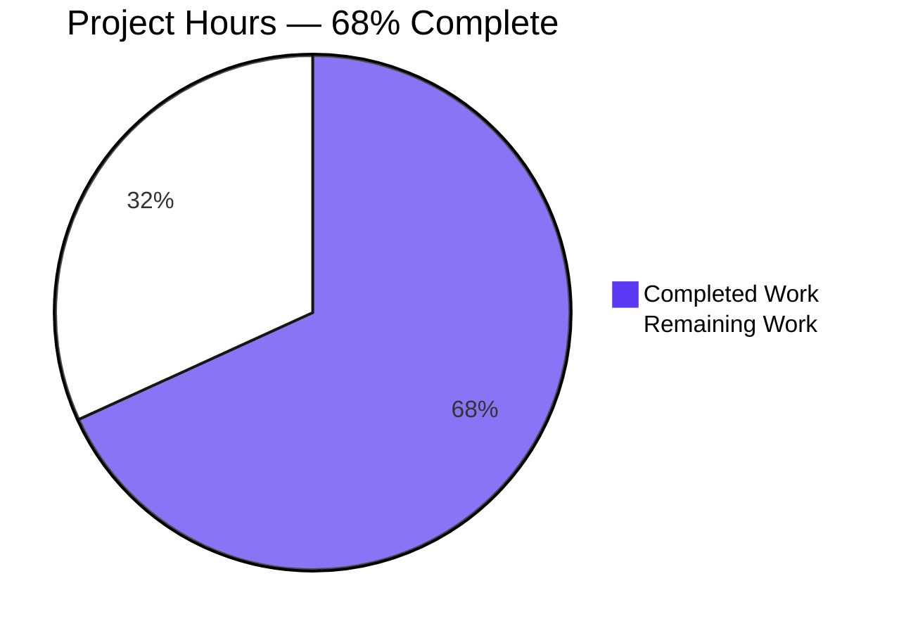
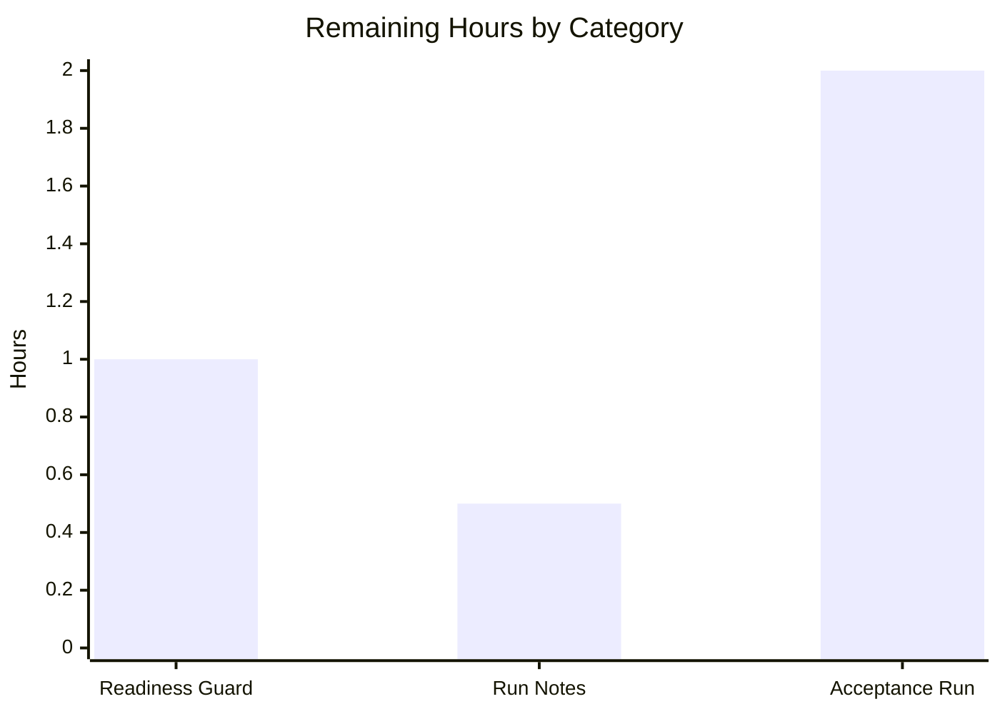

# 1. Executive Summary

## 1.1 Project Overview

A one-line Node.js HTTP server becomes a Python 3 Flask module. `app.py` at the repository root answers any path with any of the nine standard HTTP methods using the identical 14-byte body `Hello, World!\n` at status 200, listens on TCP port 3000, and prints `Server running at http://127.0.0.1:3000/` once at start-up. The legacy `server (1).js` and every other existing file stay untouched, so both runtimes coexist. The deliverable is a single sixteen-line module with no comments, no configuration surface, no error handling and no second file, on Python 3.12.3 with Flask 3.1.3 and Werkzeug 3.1.9. Local clients of the endpoint are its only users.

## 1.2 Completion Status

7.5 of 11.0 hours are complete — **68% complete**, with 3.5 hours remaining. Every requirement of the agreed plan is delivered; the outstanding hours are path-to-production items rather than build work.



Completed work is the Blitzy dark blue slice (#5B39F3); remaining work is white (#FFFFFF).

| Metric | Hours |
|---|---|
| Total Hours | 11.0 |
| Completed Hours (AI + Manual) | 7.5 |
| Remaining Hours | 3.5 |
| Completion | 68% = 7.5 ÷ 11.0 |

## 1.3 Key Accomplishments

- Any-path response: every path form exercised returns the byte-exact 14-byte body at status 200.
- Nine-method surface: all nine standard verbs answer identically, HEAD with `Content-Length: 14` and no body.
- Single-module deliverable: `app.py`, sixteen lines, no comments, no blueprint, routes module, config module or package.
- Fixed port: a literal listener on 127.0.0.1:3000 that no environment variable or flag can move.
- Start-up contract: the required line appears exactly once on stdout and never on stderr.
- Dependency posture: one import, Flask 3.1.3 with Werkzeug 3.1.9, and no manifest or lockfile introduced.
- Legacy continuity: `server (1).js`, `README.md` and the specifications document are byte-identical to their prior state.

## 1.4 Critical Unresolved Issues

3 of 22 scoped work items remain open as work — all of them path-to-production; the fourth row is an accepted caveat that needs no action.

| Issue | Impact | Owner | ETA |
|---|---|---|---|
| Readiness check for the fixed port — the start-up line is written before the bind | A supervisor keyed on that line can report the service as ready when nothing is listening | Operations | 1 h |
| Deployment run notes — interpreter, framework versions, debug-off premise (no manifest exists) | A start with the wrong interpreter fails with `ModuleNotFoundError: No module named 'flask'` | Operations | 0.5 h |
| Acceptance against the original Node server, which was never run side by side | Migration parity rests on documented framework behaviour and the stated constants | Engineering owner | 2 h |
| Accepted caveat: a request target whose decoded form embeds CR/LF reaches the framework's 404 | One path class outside the fixed response, unreachable by an ordinary client | No action required | — |

## 1.5 Access Issues

No access issues identified. The deliverable needs no external service, credential, database or third-party API, and every dependency it uses is present in the environment.

## 1.6 Recommended Next Steps

1. [Medium] Add a bind-based readiness check so a failed start cannot look ready.
2. [Medium] Record the run notes: interpreter, framework versions, debug flag unset, port 3000 exclusive.
3. [Low] Run the acceptance comparison against the original Node server.
4. [Low] Keep the debug flag unset wherever the service starts, so the start-up line stays single.

# 2. Project Hours Breakdown

## 2.1 Completed Work Detail

| Component | Hours | Description |
|---|---|---|
| Flask port of the four named behaviours | 3.0 | `app.py`: the application object, two URL rules on one view, the returned body literal, the single-line nine-method list, and the guarded start-up block — with every constraint held in the same file (no comments, no handler, no configuration surface, no second module) |
| Framework-behaviour grounding at the pinned versions | 1.0 | The documented semantics the four behaviours rest on: a returned string becomes the body at 200 with `text/html`; `app.run(port=…)` binds the port and defaults the host to loopback; the root-plus-catch-all rule pairing with `defaults`; the explicit nine-method registration; the single-emission premise of the guarded `print` |
| Full path-surface parity | 1.0 | Removing the framework's implicit static route so the port's own rules own every path, then exercising the `/static` family, `//`, dotted, unicode, encoded, deep and long path forms |
| Environment and dependency provisioning | 0.5 | Flask 3.1.3 with Werkzeug 3.1.9 available to the deliverable with no manifest created, together with the source-lineage work: the port derives from the quoted one-liner, no text is carried from the resembling Node file, and no existing file is touched |
| Runtime verification and adversarial exercise | 2.0 | The whole-package behavioural gate, the raw-socket matrix across twelve path forms and the nine verbs, boundary probes, injection payloads in path, query, body and headers, and browser confirmation |
| **Total** | **7.5** | Completed hours carried into Sections 1.2 and 7 |

## 2.2 Remaining Work Detail

| Category | Hours | Priority |
|---|---|---|
| Operational readiness guard for the fixed port — establish readiness from the bound socket, because the start-up line is written before the bind and the port is a non-configurable literal | 1.0 | High |
| Deployment run notes and version pin — the interpreter that carries the dependency, the framework versions, the debug-off premise and the exclusivity of port 3000 | 0.5 | Medium |
| Owner acceptance parity run — exercise the four behaviours and the nine methods against the original Node server and compare bytes, status, port and start-up line | 2.0 | Low |
| **Total** | **3.5** | Path-to-production only; no requirement of the agreed plan is outstanding |

# 3. Test Results

| Area / Category | Framework | Tests | Passed | Failed | Coverage | What This Proves |
|---|---|---|---|---|---|---|
| Whole-package behavioural conformance | Host behavioural gate (raw HTTP over loopback) | 18 checks | 18 | 0 | n/a | The two rule shapes answer all nine verbs with status 200 and the fixed 14-byte body (sha256 `c98c24b677eff44860afea6f493bbaec5bb1c4cbb209c6fc2bbb47f66ff2ad31`), reproduced on independent process starts |
| Path surface | Raw-socket matrix (Python standard library `socket`) | 108 checks — 12 path forms × 9 methods | 108 | 0 | n/a | Every path form exercised returns the byte-exact body with `Content-Length: 14`, including `/`, `/a/b/c`, a query-bearing path, `//`, `/static`, `/static/`, `/static/x`, `/Static/x`, `/favicon.ico`, a non-existent path and an encoded unicode path |
| Method surface | Raw socket and `curl` | 36 checks — 9 verbs × 2 path shapes, two passes | 36 | 0 | n/a | All nine standard verbs answer identically; HEAD carries `Content-Length: 14` with no body bytes on the wire; TRACE is not echoed |
| Body and header fidelity | `curl`, `od -An -tx1` | 6 checks | 6 | 0 | n/a | The body bytes are `48 65 6c 6c 6f 2c 20 57 6f 72 6c 64 21 0a` and the response carries exactly `Server`, `Date`, `Content-Type: text/html; charset=utf-8`, `Content-Length: 14` and `Connection` |
| Start-up and lifecycle | Shell, `lsof`, stream capture | 8 checks over 3 process starts | 8 | 0 | n/a | The start-up line appears exactly once on stdout and never on stderr, the listener belongs to the started process, the port is released on shutdown and no stream carries a traceback |
| Route inventory and boundary | In-process map inspection and boundary probes | 5 checks | 5 | 0 | n/a | Exactly two rules on one view, each with the nine methods, no static route and no error handler; a decoded CR/LF request target receives the framework's 404 and a non-standard verb receives 405 |
| Compilation and import | `py_compile -W all`, module import | 2 checks | 2 | 0 | n/a | The module compiles with zero warnings under the pinned runtime and imports its single dependency cleanly |
| Adversarial input handling | Raw socket, `curl`, headless Chrome | 170 cases | 170 | 0 | n/a | SQL-injection, cross-site-scripting, path-traversal, command, template-injection, CRLF and null-byte payloads delivered through the path, the query, the body and request headers leave the response byte-identical, with no reflection, no cookie and no 5xx |

No coverage tool is configured in this repository and none may be added, so the `Coverage` column carries no percentage: coverage is expressed as the checks listed.

### Not Covered

- **No repository test suite exists**, and none may be added. Nothing in the repository re-runs the checks above automatically, so they are the whole of the coverage; any future change to a rule, the body literal or the port must re-run the behavioural gate and the nine-method matrix by hand.
- **Deliberately unexercised, by agreement**: the roughly thirty-five non-standard HTTP verbs (the port answers 405 for them) and every protocol- or process-level behaviour — malformed request lines, HTTP/0.9, chunked-encoding edge cases, header-count and request-line limits, `Expect: 100-continue`, and connection reuse or pipelining.
- **Not exercised at runtime**: the port-already-in-use condition, which needs a second process contending for a host-global port, and the original Node server, which requires the lodash dependency the repository deliberately does not install — so parity against the live original is unproven and is the acceptance item in Section 1.4.
- **A human should test before release**: a fresh start plus the whole-package behavioural gate, the nine-method matrix on `/` and a multi-segment path, and the acceptance comparison against the original server.

# 4. Runtime Validation & UI Verification

Every flow below was driven against the running service on `127.0.0.1:3000`; the deliverable has no user interface beyond the rendered text body.

- ✅ **Service start-up** — `app.py` started from the checkout root: the listener on 127.0.0.1:3000 belongs to the process just started, the required line appears exactly once on stdout and never on stderr, and the first request after start succeeds.
- ✅ **Request surface** — any path, including the `/static` family, `//`, `/./`, encoded, unicode, deep and 2000–5000-character forms, driven with all nine verbs by raw socket, `curl` and a real browser: status 200 with the 14-byte body.
- ✅ **Response and method contract** — byte-exact body `Hello, World!\n` with `Content-Length: 14`, `Content-Type: text/html; charset=utf-8` and a five-header response; HEAD returns `Content-Length: 14` with zero body bytes, CONNECT answers like any other verb, TRACE does not echo the request or its headers, and OPTIONS returns the fixed body rather than an automatic empty response.
- ✅ **Query and request-body handling** — empty, repeated, 1000-character and 2000-character query values, and JSON, form-encoded, XML, malformed and 64 KiB bodies all leave the response byte-identical.
- ✅ **Header and credential probes** — forged `Host`, `X-Forwarded-*`, `Referer`, user-agent, `Authorization`, `Cookie`, `X-Api-Key` and `X-HTTP-Method-Override` headers change nothing; no `Set-Cookie` appears on any response.
- ✅ **Adversarial input** — injection, traversal, template and CRLF payloads in path, query, body and headers, plus payload URLs loaded in Chrome: no reflection, no script execution, no dialog, zero console errors.
- ✅ **Configuration immobility** — with `PORT=4000 FLASK_RUN_PORT=4000` in the process environment the service still binds 3000, nothing listens on 4000, and the start-up line still advertises 3000.
- ✅ **Concurrency, repetition and recovery** — ten simultaneous requests and several hundred sequential requests all return the fixed body with one digest and one access-log line each; after the framework's 404 the next well-formed request is correct.
- ✅ **Browser client agreement** — `/` and a deep path render the single text `Hello, World!`, with no subresource fetch, no redirect, and the request log matching the browser's own network record request for request.
- ⚠ **Framework boundary (accepted)** — a request target whose decoded form embeds CR/LF receives the framework's 207-byte 404 instead of the fixed body, and a verb outside the nine standard methods receives 405; both are outside the agreed behaviour set and no failure was observed on the fixed-response surface.

Nothing was observed failing: no endpoint, screen or flow returned an error, a 5xx, or a result other than the one the contract states.

**Never exercised at runtime**: the port-already-in-use condition (it needs a second process contending for a host-global port); the original Node server (its lodash dependency is deliberately absent from the repository, so it was never started and no side-by-side comparison was made); the roughly thirty-five non-standard HTTP verbs beyond one informational 405 check; and protocol- or process-level behaviours such as malformed request lines, HTTP/0.9, chunked-encoding edge cases, header-count and request-line limits and `Expect: 100-continue`. Authentication, session, data-store and privacy flows do not exist in this service by design, so there was nothing to drive.

# 5. Compliance & Quality Review

## 5.1 Compliance Matrix

| # | Deliverable | Benchmark | Verified Status | Progress |
|---|---|---|---|---|
| 1 | Fixed response on any path | Behaviour parity with the original server | Byte-exact 14-byte body on 108 socket checks and the gate's 18, with the `/static` family, `//`, encoded, unicode, deep and long forms all returning it | ✅ Pass |
| 2 | Nine-method surface | API contract completeness | GET, HEAD, POST, PUT, DELETE, CONNECT, OPTIONS, TRACE and PATCH registered on both rules and answered identically | ✅ Pass |
| 3 | Status contract | API contract correctness | 200 on every in-scope request; no status construct anywhere in the file | ✅ Pass |
| 4 | Port contract | Configuration discipline | Literal 3000 bound and owned by the started process; `PORT` and `FLASK_RUN_PORT` overrides ignored | ✅ Pass |
| 5 | Start-up contract | Observability | The required line appears exactly once on stdout and never on stderr, byte-exact with one line feed | ✅ Pass |
| 6 | Single-module structure | Maintainability | One module, sixteen lines, no blueprint, routes module, config module or package initialiser | ✅ Pass |
| 7 | Code hygiene | Comment discipline | Zero comments and zero docstrings; no placeholder, stub, `TODO` or dead code | ✅ Pass |
| 8 | Input and error handling | Security by construction | The view consumes no request data, returns one compile-time constant, and registers no handler; injection, traversal and CRLF payloads are inert | ✅ Pass |
| 9 | Dependency management | Supply-chain clarity | One import; Flask 3.1.3 with Werkzeug 3.1.9; no manifest, lockfile or requirements file introduced | ✅ Pass — the pin lives in the environment, not in the repository (Section 2.2) |
| 10 | Test automation | Verification repeatability | No repository suite exists or may be added; the host behavioural gate and the socket-level matrices are the coverage | ⚠ Caveat — no automated regression net inside the repository (Section 3) |
| 11 | Repository hygiene | Version-control cleanliness | One file added, nothing edited or deleted, no build output or stray artefact left in the tree | ✅ Pass |
| 12 | Legacy continuity | Migration safety | `server (1).js`, `README.md` and the specifications document are byte-identical to their prior state | ✅ Pass |

## 5.2 AAP & Rule Divergences and Gaps

| # | What the AAP/Rule Required | What Was Delivered Instead | Why It Diverged | Impact | Remediation |
|---|---|---|---|---|---|
| 1 | Line 3 of the specified file written verbatim as `app = Flask(__name__)`, with a recorded reference digest for the whole block | `app = Flask(__name__, static_folder=None)` at `app.py:3`; file 413 bytes, digest `92df605e…` | **Sanctioned.** With the default constructor the framework registers its implicit `/static/<path:filename>` rule ahead of the catch-all, so GET, HEAD and OPTIONS under `/static/` answer 404 or an empty body and the any-path behaviour — the agreement's own highest-ranked requirement, restated by the user as "match behavior exactly for the four things stated" — cannot be met. The same agreement forbids hardening beyond what replicating the behaviour needs | None functional: sixteen lines, one import, one method list, two rules, one view, one body literal, one port literal and one start-up line all remain. Only the specified listing and its recorded digest are now stale | Refresh the listing of line 3 and its recorded digest so a reader comparing them is not misled; no code change |
| 2 | "A response on any path and any of the nine standard HTTP methods" for the two declared URL rules | A request target whose decoded form embeds CR or LF is not matched by either rule and receives the framework's 207-byte 404 (observed on `/a%0ab` and on `/%0d%0a`-bearing forms) | The framework refuses to route such targets as a request-splitting defence and the catch-all's pattern cannot match them; closing it needs an extra routing rule or a 404 handler, and the user's directive forbids both | One path class outside the fixed response; not reachable from an ordinary client and it discloses nothing | None required; accepted as the framework boundary |
| 3 | Behaviour parity with the original server, with framework-default differences named once and no handling or hardening added | Delivered as-is: verbs outside the nine receive 405; Flask's two banner lines share stdout with the required line; the bind is loopback-only where the source bound all interfaces; the development WSGI server is the entry point; responses carry a version banner, a charset parameter and no TLS, security headers or CORS policy | **Sanctioned.** The user's directive states that "any method" means the nine standard verbs and that registering or testing the rest is out of scope, that nothing may be added "even where Flask's defaults differ", and that framework-default differences are to be named once rather than measured or tested | Parity holds for the four named behaviours and the nine registered methods; the differences lie outside that set | None; closing any of them requires code the same directive forbids |
| 4 | A start-up message emitted on successful listening, as the original server's callback did | `print(...)` runs immediately before `app.run(port=3000)` (`app.py:15–16`), so the line also appears when port 3000 is already in use and the bind then fails | The agreed plan raised this as an open question and left it open; matching the source would need an explicit server object plus `serve_forever()`, machinery the directive forbids in a file that must stay a plain single-file application | The line is not a readiness signal: a supervisor keyed on it can report a dead service as ready | Establish readiness from the bound socket — Section 2.2, High priority |

**1. Divergence on line 3.** The agreed file listing writes line 3 as `app = Flask(__name__)` and records a reference digest for the block; the delivered file reads `app = Flask(__name__, static_folder=None)` (`app.py:3`), 413 bytes, digest `92df605e…`. The same agreement makes the four named behaviours the bar every other requirement is subordinate to, and the user restated that bar as "match behavior exactly for the four things stated above". With the default constructor, Flask registers `/static/<path:filename>` ahead of the catch-all and answers GET, HEAD and OPTIONS under `/static/` with 404 or an empty body, so the literal cannot meet the any-path behaviour. The departure is sanctioned and the file keeps every other element of the specified shape; only the listing text and its recorded digest are stale, and whoever owns that description should refresh them.

**2. Divergence on the path surface.** The agreement states that the request surface is both URL rules and that any path returns the fixed body. A request target whose decoded form embeds CR or LF is matched by neither rule and receives the framework's 207-byte 404 — observed directly on `/a%0ab` and on the percent-encoded CRLF forms. The framework refuses to route such targets as a request-splitting defence, and the catch-all's pattern cannot match them; the only changes that would close the gap are an extra routing rule or a 404 handler, both forbidden by the user's directive. The class is unreachable from an ordinary client and discloses nothing, so it is accepted as the framework boundary rather than recorded as a defect.

**3. Divergence on the accepted framework-default class.** The user's directive is explicit: "any method" means the nine standard verbs and registering or testing the rest is out of scope; nothing may be added "even where Flask's defaults differ"; and framework-default differences are to be named once rather than measured or tested live. The delivery honoured that: the roughly thirty-five other verbs receive 405, Flask's own banner lines share stdout with the required line, the bind is loopback-only, the development WSGI server is the entry point, and responses carry a version banner, a charset parameter and no TLS, security headers or CORS policy. Parity holds for the four named behaviours and the nine registered methods, which is the bar the same directive sets, so no remediation is owed.

**4. Divergence on the start-up signal.** The original server printed its message only after a successful bind, because its callback ran once listening had begun. The delivered code prints immediately before `app.run(port=3000)` (`app.py:15–16`), so the line appears even when port 3000 is already in use and the process then fails to bind. The agreed plan raised this as an open question and left it open rather than closed; matching the source needs an explicit server object plus `serve_forever()`, which the directive forbids in a file that must stay a plain single-file application. The consequence is operational, not functional: the line must not be used as a readiness signal, and the readiness check in Section 2.2 supplies the alternative.

No other divergence from the agreed plan or from the user's directives was identified: eighteen of the nineteen requirements are met exactly as stated and the nineteenth is met under a higher-ranked part of the same agreement. No user-specified rule exists for this project, so no rule can be departed from.

# 6. Risk Assessment

| Risk | Category | Severity | Probability | Mitigation | Status |
|---|---|---|---|---|---|
| No regression net inside the repository: no suite exists and none may be added, so an edit to a rule, the body literal or the port is unprotected | Technical | Medium | Medium | Re-run the behavioural gate and the nine-method matrix on every change; treat the response contract as frozen | Open |
| The single-emission guarantee is environmental: a truthy debug flag enables the reloader and would print the start-up line twice | Technical | Low | Medium | Keep the debug flag unset in every environment that starts the service; record it in the run notes | Open |
| Port 3000 is fixed and non-configurable: a second instance cannot coexist, and a failed bind still prints the start-up line, so a supervisor can read a dead service as ready | Operational | High | Medium | Establish readiness from the bound socket and take exclusive ownership of the port | Open — work item (Section 2.2) |
| No dependency manifest exists by design, so the start command must name the interpreter that carries Flask; a bare `python3 app.py` fails with `ModuleNotFoundError: No module named 'flask'` | Operational | Medium | High | Deployment run notes naming the interpreter and versions, plus a per-checkout virtual environment as the portable alternative | Open — work item (Section 2.2) |
| The endpoint is served by the framework's development server on loopback only, with no TLS, security headers or CORS policy | Operational / Security | Medium | Low | Keep the bind loopback-only; any wider exposure is a new decision for the owner, not a configuration change | Accepted by design |
| Responses disclose the framework and interpreter versions, and any local process that reaches 127.0.0.1:3000 receives the fixed response, with no identity, rate limiting or input layer | Security | Low | Low | The loopback bind is the compensating control; the agreement forbids adding hardening | Accepted by design |
| Parity against the live original server is unproven: it has never been started here, because its lodash dependency is deliberately absent from the repository | Integration | Low | Low | Run the side-by-side acceptance comparison of the four behaviours and the nine methods | Open — work item (Section 2.2) |
| The four behaviours rest on the installed framework versions (Flask 3.1.3 with Werkzeug 3.1.9); a different environment could alter a framework default they depend on | Integration | Low | Low | Pin the installed versions in the run notes and keep the environment that carries the deliverable | Open |

# 7. Visual Project Status


Completed work is the Blitzy dark blue slice (#5B39F3); remaining work is white (#FFFFFF). The centre figure is the AAP-scoped completion: 7.5 of 11.0 hours, **68% complete**.



| Remaining Category | Hours | Priority | Blocks release |
|---|---|---|---|
| Operational readiness guard for the fixed port | 1.0 | High | Only if the service is deployed under a supervisor |
| Deployment run notes and version pin | 0.5 | Medium | No — but a wrong interpreter prevents start-up |
| Owner acceptance parity run against the original server | 2.0 | Low | No — acceptance evidence only |
| **Total** | **3.5** | — | — |

All remaining hours are path-to-production; no requirement of the agreed plan is outstanding, and the completed figure above matches Section 2.1 (7.5 h) and Sections 1.2 and 2.2.

# 8. Summary & Recommendations

The port is delivered and exercised. `app.py` — sixteen lines at the repository root, one import, one method list, two URL rules on a single view, one body literal, one port literal and one start-up line — reproduces the four behaviours the original Node server carried: any path and any of the nine standard methods return the byte-exact 14-byte body `Hello, World!\n` at status 200, the process listens on TCP port 3000, and `Server running at http://127.0.0.1:3000/` is printed exactly once on stdout. Verification was behavioural, because no test suite exists in the repository and none may be added: the whole-package conformance gate passed 18 of 18 checks, a raw-socket matrix over twelve path forms and nine verbs passed 108 of 108 rows with a single body digest, HEAD returned `Content-Length: 14` with no body, the `/static` family and the deep, encoded, unicode and long path forms all reached the view, and injection, traversal and CRLF payloads driven through path, query, body and headers left the response byte-identical. The legacy `server (1).js`, `README.md` and the shipped specifications document are byte-identical to their prior state.

Measured against the agreed plan, completion stands at **68%** — 7.5 hours of 11.0. That figure reflects the hours the work took, not a shortfall in scope: every one of the nineteen requirements is delivered and verified, and the remaining 3.5 hours are path-to-production items rather than build work. Those items are a readiness check for the fixed port (1.0 h, High), run notes that name the interpreter, versions and debug-off premise (0.5 h, Medium), and a side-by-side acceptance run against the original Node server (2.0 h, Low). Four divergences are recorded in Section 5.2: one sanctioned departure from the specified listing of line 3, where the higher-ranked any-path behaviour required an extra constructor argument; the accepted framework boundary that gives a CR/LF-bearing request target a 404; the accepted framework-default class the directive waived verbatim; and the start-up line that precedes the bind. None of them blocks release, and only the first needs any human action — a text refresh.

The critical path to production is short and operational. First, establish readiness from the bound socket rather than from the start-up line, because the line is written before the bind and port 3000 is a non-configurable literal that another process can hold; a supervisor keyed on the line alone can report a dead service as ready. Second, capture the run notes: which interpreter carries Flask 3.1.3 with Werkzeug 3.1.9, that the debug flag must stay unset so the line is emitted once, and that the port is exclusive. Third, complete acceptance by running the original server beside the port and comparing the four behaviours and the nine methods, the one piece of evidence this work could not produce because the original's dependency is deliberately absent from the repository.

Success metrics for sign-off: the response contract holds byte-for-byte (`48 65 6c 6c 6f 2c 20 57 6f 72 6c 64 21 0a`, 14 bytes, `Content-Length: 14`) on every path and verb exercised; the port contract resists `PORT` and `FLASK_RUN_PORT` overrides; the start-up line is emitted once on stdout and never on stderr; the module compiles with zero warnings and holds no comment, placeholder or dead code; and no existing file was modified or deleted.

Production readiness: **ready for its intended deployment** — a loopback-bound, single-file service that returns one constant, on the pinned framework, exactly as the agreement specifies. It is deliberately not hardened: no TLS, no security headers, no CORS policy, no authentication, no rate limiting, no error handler and the framework's development server, each of them required to be absent by the same agreement and matching what the original source had. Treat any exposure beyond loopback as a new decision with its own design, and keep the two operational facts above — the interpreter and the port — in the team's run book.

# 9. Development Guide

Every command below was run in this checkout against the delivered tree; expected output is what was observed.

### System Prerequisites

- Python 3.12 (3.12.3 on the host this was built on). Check with `python3.12 --version`.
- Network access to a package index only if you build your own virtual environment; where the platform already provides an environment carrying Flask, none is needed.
- `curl` and `lsof` for the verification steps. No database, broker, container, VPN or external endpoint is involved.
- Node.js is present only for the untouched legacy `server (1).js`; the deliverable does not use it.

### Environment Setup

```bash
cd /path/to/your/checkout
python3.12 -m venv .venv                 # untracked; never commit it
.venv/bin/pip install flask==3.1.3
.venv/bin/python -c "import importlib.metadata as m; print(m.version('flask'), m.version('werkzeug'))"
# → 3.1.3 3.1.9
```

If your platform already provisions an interpreter with Flask 3.1.3 installed, point `PROJECT_PYTHON` at it instead of creating `.venv`:

```bash
export PROJECT_PYTHON=/path/to/interpreter-with-flask
```

Keep the virtual environment, the log files and the pid file outside the repository, or delete them after a run: no `.gitignore` exists and none is to be added, so anything you leave behind shows up as an untracked file.

### Dependency Installation

```bash
.venv/bin/pip install flask==3.1.3       # brings Werkzeug 3.1.9, Jinja2, MarkupSafe, itsdangerous, click, blinker
.venv/bin/pip check                      # → No broken requirements found.
```

No manifest, lockfile or requirements file exists in this repository and none should be created; the pin lives in the environment.

### Compile

```bash
PYTHONPYCACHEPREFIX="$PWD/.pycache" python3.12 -m py_compile app.py; echo "exit=$?"
# → exit=0
```

### Application Startup

```bash
nohup .venv/bin/python app.py > app.out 2> app.err &
echo $! > app.pid
sleep 3
lsof -nP -iTCP:3000 -sTCP:LISTEN         # → the pid you just started, on 127.0.0.1:3000
```

The port is a literal in `app.py` and cannot be changed by any environment variable or flag, and only one process may hold it. The start-up line is written before the bind is attempted, so confirm the listener exists rather than trusting the line.

### Verification Steps

```bash
grep -Fxc 'Server running at http://127.0.0.1:3000/' app.out    # → 1
grep -Fxc 'Server running at http://127.0.0.1:3000/' app.err    # → 0
curl -s -o /dev/null -w 'GET / -> %{http_code} %{size_download} bytes\n' http://127.0.0.1:3000/
# → GET / -> 200 14 bytes
curl -s http://127.0.0.1:3000/a/b/c | od -An -tx1
# →  48 65 6c 6c 6f 2c 20 57 6f 72 6c 64 21 0a
curl -s http://127.0.0.1:3000/a/b/c | sha256sum
# → c98c24b677eff44860afea6f493bbaec5bb1c4cbb209c6fc2bbb47f66ff2ad31
for m in GET HEAD POST PUT DELETE CONNECT OPTIONS TRACE PATCH; do
  printf '%-8s %s\n' "$m" "$(curl -s -o /dev/null -w '%{http_code} %{size_download}' -X "$m" http://127.0.0.1:3000/)"
done
# → every line 200 14, except HEAD 200 0
```

Where your host provides its behavioural conformance gate, run it with the same interpreter while the service is up: it drives the nine methods against `/` and a multi-segment path and reports `18/18 checks passed` with exit 0.

### Shutdown

```bash
kill "$(cat app.pid)"
lsof -nP -iTCP:3000 -sTCP:LISTEN         # silent: the port is released
```

### Example Usage

```bash
curl -i http://127.0.0.1:3000/
# HTTP/1.1 200 OK
# Server: Werkzeug/3.1.9 Python/3.12.3
# Date: ...
# Content-Type: text/html; charset=utf-8
# Content-Length: 14
# Connection: close
#
# Hello, World!

curl -s -X POST http://127.0.0.1:3000/any/deep/path      # → Hello, World!
curl -s -X OPTIONS http://127.0.0.1:3000/static/x        # → Hello, World!   (no static route exists)
curl -I  http://127.0.0.1:3000/anything                  # → 200, Content-Length: 14, no body
```

### Troubleshooting

| Symptom | Cause | Resolution |
|---|---|---|
| `ModuleNotFoundError: No module named 'flask'` | The interpreter does not carry Flask (the container default `python3` is 3.13.7 without it) | Run with the environment that holds Flask 3.1.3, or create `.venv` as above |
| `Address already in use` / `Port 3000 is in use by another program` | The port is a fixed, host-global literal | Find the owner with `lsof -nP -iTCP:3000 -sTCP:LISTEN` and stop it; the start-up line may already have been printed, since it precedes the bind |
| The start-up line appears twice | A truthy debug flag (for example `FLASK_DEBUG=1`) enabled the reloader | Start the service with the debug flag unset |
| `/a%0ab` (or any target embedding CR/LF) returns a 404 page | The framework refuses to route such request targets before the rules are consulted | Expected framework boundary; not a defect |
| A non-standard verb returns 405 | Only the nine standard verbs are registered | Expected; parity was agreed for the nine |
| The gate reports a start-up failure instead of counts | No listener on 127.0.0.1:3000 | Start the service first, then run the gate |
| `git status` shows untracked files after a run | Logs, pid file or virtual environment inside the checkout | Keep them outside the repository or delete them; no `.gitignore` exists |

# 10. Appendices

## A. Command Reference

| Command | Purpose | Observed result |
|---|---|---|
| `python3.12 --version` | Confirm the runtime | `Python 3.12.3` |
| `.venv/bin/pip install flask==3.1.3` | Provision the one dependency | Installs Flask 3.1.3 with Werkzeug 3.1.9 |
| `.venv/bin/pip check` | Confirm the environment is consistent | `No broken requirements found.` |
| `PYTHONPYCACHEPREFIX="$PWD/.pycache" python3.12 -m py_compile app.py` | Compile check, bytecode outside the tree | exit 0, no warnings |
| `nohup .venv/bin/python app.py > app.out 2> app.err & echo $! > app.pid` | Start the service detached | Listener on 127.0.0.1:3000 owned by that pid |
| `lsof -nP -iTCP:3000 -sTCP:LISTEN` | Confirm the listener and its owner | One line naming the started pid |
| `grep -Fxc 'Server running at http://127.0.0.1:3000/' app.out` | Count the start-up line on stdout | `1` |
| `grep -Fxc 'Server running at http://127.0.0.1:3000/' app.err` | Confirm it is absent from stderr | `0` |
| `curl -s -o /dev/null -w '%{http_code} %{size_download}' http://127.0.0.1:3000/` | Smoke request | `200 14` |
| `curl -s http://127.0.0.1:3000/a/b/c \| sha256sum` | Verify the body digest | `c98c24b677eff44860afea6f493bbaec5bb1c4cbb209c6fc2bbb47f66ff2ad31` |
| Host behavioural conformance gate, same interpreter | Whole-package check over the nine methods on two path shapes | `18/18 checks passed`, exit 0 |
| `kill "$(cat app.pid)"` | Stop the service | Port 3000 released, no traceback in either stream |

## B. Port Reference

| Port | Bind | Used by | Notes |
|---|---|---|---|
| 3000 | 127.0.0.1 (loopback) | `app.py` — the whole service | A literal in the file: no environment variable, flag or configuration file can change it. One process may hold it at a time, and it is shared host-wide |

## C. Key File Locations

| Path | Role |
|---|---|
| `app.py` | The deliverable: the complete single-module Flask application |
| `README.md` | Pre-existing project readme describing the legacy Node run; unmodified |
| `server (1).js` | The legacy Node source, unmodified; needs `lodash`, which is deliberately not installed |
| `blitzy/documentation/Technical Specifications.md` | Pre-existing shipped specification; unmodified |

## D. Technology Versions

| Component | Version | Role |
|---|---|---|
| Python | 3.12.3 | Runtime the deliverable runs on |
| Flask | 3.1.3 | The only package the file imports |
| Werkzeug | 3.1.9 | WSGI server that binds the port and router that matches the rules |
| Jinja2 | 3.1.6 | Flask dependency; not used by the file |
| MarkupSafe | 3.0.4 | Flask dependency; not used by the file |
| itsdangerous | 2.2.0 | Flask dependency; not used by the file |
| click | 8.5.0 | Flask dependency; not used by the file |
| blinker | 1.9.0 | Flask dependency; not used by the file |
| Node.js | v22.23.3 | Present for the legacy `server (1).js` only |

## E. Environment Variable Reference

The deliverable reads no environment variable. The table records what was exercised anyway.

| Variable | Effect on this service | Note |
|---|---|---|
| `FLASK_DEBUG` | None on the port; a truthy value enables the reloader and prints the start-up line twice | Keep it unset wherever the service starts |
| `PORT`, `FLASK_RUN_PORT` | None — tested with `4000`, the service still bound 3000 and nothing listened on 4000 | The port is a literal |
| `FLASK_APP` | None — the module is run directly as a script | Not used |

## F. Developer Tools Guide

- **Interpreter**: `python3.12` on PATH is the pinned runtime; the container default `python3` is a different, newer interpreter without Flask.
- **Virtual environment**: `.venv` inside the checkout, untracked. Never commit it, and never add a manifest.
- **Bytecode**: keep it out of the tree with `PYTHONPYCACHEPREFIX="$PWD/.pycache"` or by running `python -B`.
- **Quality gates available**: `py_compile -W all` for a syntax and warning check, the host behavioural gate for whole-package conformance, and `curl`/`od`/`sha256sum` for byte-level proof. No linter, formatter or type checker exists in this repository and none may be added.
- **Legacy comparison**: to run the Node original, copy `server (1).js` out of the checkout and install its `lodash` dependency in that separate directory; the repository must stay free of `node_modules` and of any manifest.

## G. Glossary

| Term | Meaning |
|---|---|
| Fixed response | The constant 14-byte body `Hello, World!\n` returned for every request the service routes |
| Catch-all rule | The `/<path:path>` rule whose converter accepts slashes, so one rule serves every non-root path |
| Companion root rule | The `"/"` rule carrying `defaults={"path": ""}`, needed because the catch-all's pattern requires at least one character after the slash |
| Methods list | The single-line list naming the nine standard verbs, referenced by both rules |
| Development server | The WSGI server the framework starts in-process; suitable for local service, not for public exposure |
| Readiness signal | Evidence that a service has bound its port; the start-up line is not one here, because it is written before the bind |
| Byte-for-byte parity | Equality of the response bytes, not of the source syntax — here 14 bytes ending in one line feed |
| HEAD semantics | Status and headers as for GET, with no body on the wire |
| Exotic verbs | HTTP methods outside the nine standard verbs, which the service answers 405 and never registers |
